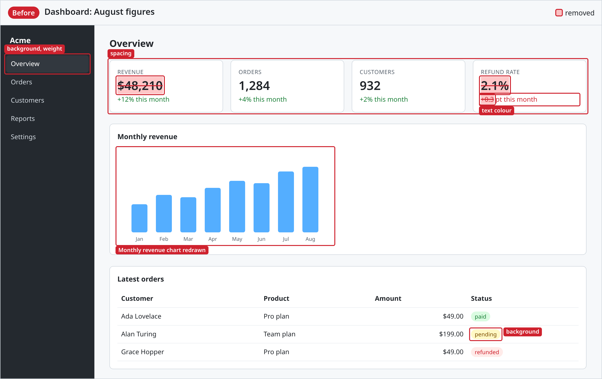
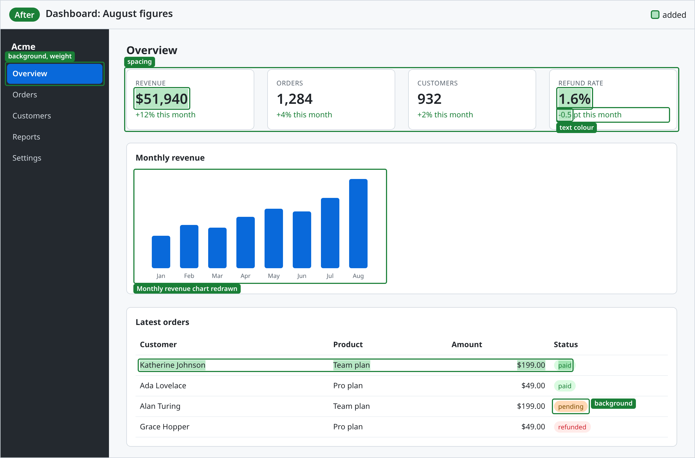

# shot-diff

Before and after screenshots of a web page, with the change marked, ready to paste in a pull request.

- On the **before** shot, what was removed is red and struck through.
- On the **after** shot, what was added is green.
- A change with no words in it is marked too: a box says what changed on an element whose look
  changed (a colour, a border, a size), or on a picture redrawn under the same file name; and an
  element with no words that was added or removed, a divider or a progress bar, gets a box saying
  so.
- Each image has a band on top with its side, your title, and what its colour means.

A dashboard where numbers, a row, a chart and some styles changed:

| Before | After |
|---|---|
|  |  |

More in [examples/](examples/README.md), each with its command.

## Quick start

You need Node.js 22.18 or later. You give it two addresses of the same page, before and after the
change, and a title:

```sh
npx @yannickbaudraz/shot-diff <before-url> <after-url> --title "What changed"
```

It writes `shot-before.png` and `shot-after.png` in the current folder. The first run may ask to
download a browser (see [Browser](#browser)).

## Get the two addresses

You need the page as it was and the page as it is now, both reachable at the same time. Pick the
first way that fits.

**1. The site is already online, and the pull request has a preview.** Many projects deploy each
pull request to its own address (Netlify, Vercel, Cloudflare Pages, GitHub Pages): look for a
"deploy preview" link in the pull request's checks or comments. Use the live site as before and the
preview as after. Nothing to install or start:

```sh
npx @yannickbaudraz/shot-diff \
  'https://<live-site>/pricing' \
  'https://<preview>/pricing' \
  --title "Pricing: the new plans" --selector main
```

Replace `<live-site>` with your site's address, and `<preview>` with the address the preview link
opens. Each host names its previews its own way: on Netlify, for instance, it looks like
`deploy-preview-123--my-site.netlify.app`. A preview usually lasts only while its pull request is
open: take the shots before it is merged or closed.

The live site may have moved on since the pull request started; those changes show up too. Compare
with a preview of the base branch instead when the project has one.

**2. The site builds to static files.** Build each version into its own folder and point at the
files, no server needed:

```sh
git worktree add ../before main          # the base branch, next to your checkout
(cd ../before && npm ci && npm run build)
npm run build                            # your branch
npx @yannickbaudraz/shot-diff file://$PWD/../before/dist/index.html file://$PWD/dist/index.html --title "Home"
```

The build folder may be `dist`, `build` or `out`, depending on the project. If the page comes out
without its styles, the build links its files from the site's root, which a `file://` address does
not have: serve each folder instead, with `npx serve dist -l 3000` and `-l 3001`, and use way 3.

**3. The app needs a server.** Start the base branch on one port and your branch on another, then
point at both:

```sh
npx @yannickbaudraz/shot-diff http://localhost:3000/cart http://localhost:3001/cart --title "Cart: the empty state"
```

Both pages load at the same size, in the same colour scheme, with the same stored settings and
clicks, so the only difference is the change.

## Shoot only one part of the page

By default it shoots the area around the changes, wherever they are. When the page has changes you
do not care about (a rotating ad, a date, a menu), name the part you do care about with
`--selector`:

```sh
--selector main          # or article, .content, #pricing: any CSS selector
```

Only the changes inside that element count: in it in the page's HTML, not just drawn over it.
Everything else is ignored, a menu above it, a column beside it, a wrapper around it: it is in no
image and left unmarked, and the command says how many changes it ignored. The shots are still cut
around the changes inside the element, not the whole element.

To find a selector, open the page in your browser, right-click the part you want, choose
**Inspect**, and use the element's `id` (`#name`) or a class (`.name`) shown there.

## Read the result

[examples/](examples/README.md) shows each of these: the command, what it prints, and its images.

- **One pair of images** when all the changes fit in one image.
- **Several numbered pairs** (`shot-1-before.png`, `shot-1-after.png`, `shot-2-…`) when changes are
  far apart. The band says "1 of 3", and so on.
- **"N change(s) are cut from every image"** on the terminal: a change is taller than one image may
  be. Raise `--max-height`, or narrow the shot with `--selector`.
- **"N change(s) outside --selector ignored"**: changes it found outside the element you named. That
  is expected; `--json` lists them under `ignored` if you want to check.
- **"N change(s) are in a part of the page a scroll area cuts off"**: the change is on the page, but
  inside a scroll area (a sidebar, a code block, a panel) past what it shows, so no screenshot can
  show it. The list tells you what to look at in the browser.
- **"no difference"**: both pages look the same to it. Check the two addresses are really the two
  versions.

`--json` prints all of this as JSON: for each image, its file, what it marks and where; then
`leftOut` (cut from every image), `hidden` (cut off by a scroll area) and `ignored` (outside
`--selector`).

## Get the page in the right state

### By hand

When the page needs more than a click before it looks right (something typed, a login, items in a
cart), add `--interactive`:

```sh
npx @yannickbaudraz/shot-diff http://localhost:3000/cart http://localhost:3001/cart \
  --title "Cart: two items" --interactive
```

Two Chrome windows open, one on each page, and the terminal says which address is the before page
and which is the after. Do the same thing in both windows: click, type, log in. Then go back to the
terminal and press Enter: both pages are shot as you left them. Answer `n` instead to stop without
shooting.

- **Do the same steps in both windows.** Anything you do in one only shows up as a change.
- **Keep one tab per window.** Only one can be shot. If a link opened another, close the ones you do
  not want: it asks again until each window has one tab left, and shoots that one.
- **Scroll both pages to the same place**, or back to the top: a header that stays on screen is
  drawn where each page is scrolled to.
- What shows only while the pointer is over it (a tooltip, a hover colour) is not shot: the pointer
  can be over one window only, so it is taken off both.
- It needs a screen, and you at the terminal. On CI, use the options below instead.
- **The size of a window does not matter.** Each page keeps the size set with `--width` and
  `--height`, however you resize its window, so both are always the same size. And the images are
  cut around the changes, not around what the window shows: to shoot one part, use `--selector`.

Add `--tabs` to get one window with the two pages as tabs, not a window each:

```sh
npx @yannickbaudraz/shot-diff http://localhost:3000/cart http://localhost:3001/cart \
  --title "Cart: two items" --interactive --tabs
```

- **Resize the window to choose the size of the page**: both tabs take it, a moment after you let
  go, as on a narrower or wider screen. That is the size the pages are shot at.
- **The window must have two tabs when you press Enter**, the before page and the after page. A tab
  one of them opened can take its place; close any other.
- **One window is one browser session.** The two pages share their cookies when they are on the
  same host, and `localhost:3000` and `localhost:3001` are: a login or a cart kept in a cookie on
  one applies to the other. With two windows, each page has its own.
- On WSL, the windows are Chrome for Windows (see [Browser](#browser)).

### With options

The same every time, with nobody there:

| You want | Add |
|---|---|
| A phone-sized page | `--width 390 --height 844` |
| Dark mode | `--dark` |
| A menu or dialog opened first | `--click "#menu-button"` (repeat for several clicks, in order) |
| A setting the page reads at load, such as a dismissed banner | `--storage banner-closed=true` |
| More time for the page to settle | `--wait 1000` (milliseconds) |
| Numbered boxes, explained in the band, instead of labels over the page | `--markers numbers` |

## Options

| Option | Default | What it does |
|---|---|---|
| `--title <text>` | required | the title in the band |
| `--out <dir>` | `.` | the folder the images go in |
| `--name <name>` | `shot` | the start of the file names: `<name>-before.png`, `<name>-after.png` |
| `--selector <css>` | | only count the changes inside this element |
| `--width`, `--height` | 1280, 900 | the browser window, in pixels |
| `--scale` | 2 | pixel density: 2 makes sharp images, 1 smaller files |
| `--dark` | | dark colour scheme |
| `--storage key=value` | | set in `localStorage` before the page runs (repeatable) |
| `--click <selector>` | | click after loading, in order (repeatable) |
| `--wait <ms>` | 300 | wait after loading and clicking |
| `--interactive` | | open both pages in windows, and shoot them once you have set them up by hand |
| `--tabs` | | with `--interactive`: one window with both pages as tabs, which you can resize |
| `--markers labels\|numbers` | `labels` | on a box around a change of look: what changed written on it, or a number explained in the band |
| `--padding <px>` | 80 | room kept around the changes |
| `--max-height <px>` | 2400 | the tallest an image gets; changes further apart get their own pair |
| `--chrome <path>` | Google Chrome, or `$CHROME` | another Chrome or Chromium to use |
| `--download`, `--no-download` | ask | without Chrome: download one without asking, or stop |
| `--json` | | print what was marked, where, and what was left out or ignored |

## Browser

It uses Google Chrome if it is installed, without opening a window, except with `--interactive`.
Without it, it offers to download Playwright's Chromium (about 100 MB, once; about 200 MB for the
one that opens windows, with `--interactive`) and waits for a yes. Where nobody can answer,
as on CI, it stops instead: add `--download` to allow the download up front, or `--chrome <path>`
to use another Chrome or Chromium.

On WSL, `--interactive` opens Chrome for Windows, the one on your desktop, not the Linux one. It
starts it with a profile of its own, removed after: your tabs, logins and extensions are not in it.
A `file://` page in WSL is opened from Windows, and `localhost` is the same on both. The pages are
then drawn with Windows fonts, so the shots differ a little from the ones made without
`--interactive`, which the Linux Chrome draws. This needs Chrome installed on Windows, and WSL
sharing localhost with it (`networkingMode=mirrored` in `.wslconfig`); otherwise the Linux Chrome
opens. To get the Linux one anyway, name it: `--chrome /usr/bin/google-chrome`.

## How it works

1. It loads both pages in Chrome through Playwright and reads every visible word and image, in the
   order the page shows them, inside web components (their shadow trees) too. Hidden text is left
   out.
2. It diffs the two word lists (Myers' algorithm, as `git diff` uses for lines, from the
   [`diff`](https://github.com/kpdecker/jsdiff) package).
3. On the before page it tints the removed words red and strikes them through; on the after page it
   tints the added words green. A box goes around each change. Both are drawn over the page (the
   CSS Custom Highlight API and an overlay), so nothing on it moves.
4. It pairs the elements of the two pages the same way, by tag, id, role, own words and image file;
   then, between two elements it paired, the ones left over on both pages by their tag alone, so an
   element whose words changed is still paired with the one in its place. It compares what the
   browser computed for each pair: colours, borders, corners, shadow, font,
   spacing, alignment, and the size of elements with nothing inside them. A border or an outline
   counts only where one is drawn. Images, canvases, SVGs, embedded pages (iframes) and backgrounds
   with no element inside them that kept their style are compared pixel by pixel
   ([pixelmatch](https://github.com/mapbox/pixelmatch)), at the smaller of their two sizes when the
   layout scaled one.
   An element with no word or image in it that only one page has, with nothing inside it that the
   other page has too, is a change as well: "removed" on the before shot, "added" on the after.
   One inside another is the outer one's, so a component added is boxed once. Its words, when it
   has some, already say it: an element with words is marked by them alone.
   Each change gets a box with what changed written on it, or a number explained in the band with
   `--markers numbers`: red on the before shot, green on the after.
5. It shoots the area around the changes, unchanged words next to each change included, so both
   shots show the same place even when one side of a change is empty. With `--selector`, it first
   drops the changes outside the element's tree, and takes their marks off. A box goes around what
   a scroll area shows of a change; a change it shows none of gets no box and is listed instead.
   Changes far apart are shot apart, and an edge of a shot never cuts a line of text in half.
6. It draws the band on each shot with [sharp](https://sharp.pixelplumbing.com).

## Limits

- An element is matched across the pages by its tag, id, role, own words and image file. One whose
  words changed is matched with the element of the same tag in its place, and a change of its look
  is marked beside its words; where elements were also added or removed around it, that match can
  be with a neighbour. One that moved elsewhere in the page is not matched, and with no words in it
  is marked removed where it was and added where it is.
- Among elements alike, with no words to tell them apart, the one added or removed cannot be told
  from its neighbours: of three dividers where there were two, the box may go on another than the
  new one.
- An element added with words in it is marked by its words, and by the elements with no words
  inside it: a new panel has its text tinted and its progress bars boxed, and no box around its
  own frame.
- Pseudo-elements (`::before`, `::after`) and position on the page are not compared: an element
  pushed down by text added above it is not a change.
- Moved text shows as removed in one place and added in another.
- A background image redrawn under the same file name is marked only on an element with no other
  element inside it: a shot of a banner with a heading on it holds the heading too, so its pixels
  are not compared. A background whose file name changed is marked, as a change of style.
- The words inside an embedded page (an iframe) are not read. When it is drawn differently, the
  whole iframe is boxed as an "embedded page", without saying what changed in it. One that differs
  from one load to the next, as an ad or a video does, is boxed too: name the part you care about
  with `--selector` to leave it out.
- A web component's shadow tree is read when it is open, as most are. A closed one cannot be reached
  from the page, so a change inside it is not seen. `--selector` finds its element in the page
  itself, not inside a shadow tree; the shadow trees inside that element count.

## Develop

```sh
npm install
npm test          # vitest, needs Chrome: units in Node, src/page/runtime.ts in Chrome (browser mode),
                  # the command on fixture pages, and its images against e2e/__image_snapshots__
npx vitest run -u # update the reference images after a change meant to alter them
npm run check     # types
npm run build     # vite: dist/cli.js
```

The reference images depend on the fonts of the machine that made them, so CI does not compare them.
