# Examples

What to expect from each kind of result. Every example is the command run on the test pages of this
repository, from its root: the command, what it prints on the terminal, and the images it writes.

This page and the images are made by `npm run examples`: do not edit them by hand. Text is drawn
with the fonts of the machine that made them, so yours may differ a little.

## Changed words

Removed words are red and struck through on the before shot; added words are green on the after shot. Each change has a box.

```sh
shot-diff "file://$PWD/e2e/fixtures/words/before.html" "file://$PWD/e2e/fixtures/words/after.html" \
  --title "Changed words"
```

```
examples/words/shot-before.png: 1 part(s) removed
examples/words/shot-after.png: 2 part(s) added
```

| Before | After |
|---|---|
| 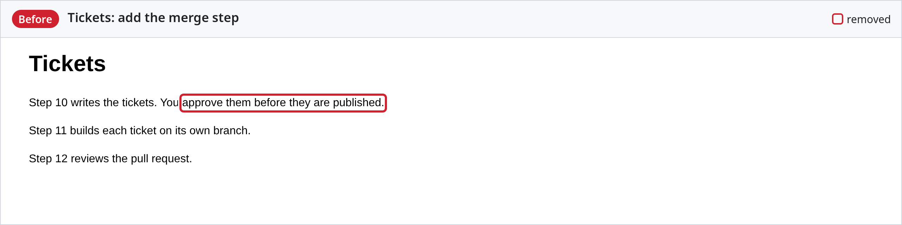 | 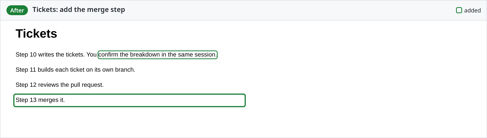 |

## Changed looks and pictures

An element restyled, or a picture redrawn under the same file name, has no changed word: it gets a box with what changed written on it.

```sh
shot-diff "file://$PWD/e2e/fixtures/visual/before/index.html" "file://$PWD/e2e/fixtures/visual/after/index.html" \
  --title "Changed looks and pictures"
```

```
examples/looks/shot-before.png: 3 part(s) removed
examples/looks/shot-after.png: 3 part(s) added
```

| Before | After |
|---|---|
| 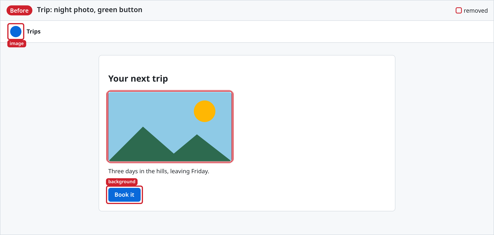 | 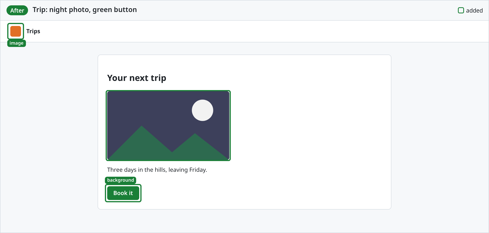 |

## A page with both

Words and looks changed on one page. Only what changed is marked, not the boxes the layout resized around it.

```sh
shot-diff "file://$PWD/e2e/fixtures/dashboard/before.html" "file://$PWD/e2e/fixtures/dashboard/after.html" \
  --title "A page with both"
```

```
examples/whole-page/shot-before.png: 6 part(s) removed
examples/whole-page/shot-after.png: 7 part(s) added
```

| Before | After |
|---|---|
| 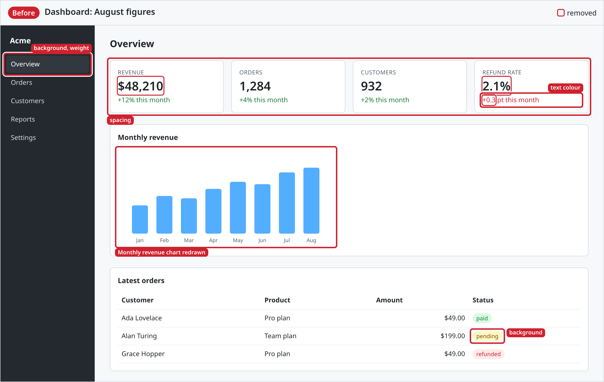 | 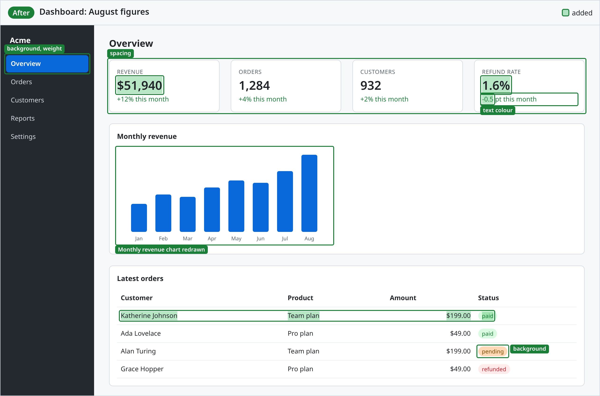 |

## Numbered boxes

With `--markers numbers`, each box of a change of look has a number, explained in the band, where a label would cover the page.

```sh
shot-diff "file://$PWD/e2e/fixtures/dashboard/before.html" "file://$PWD/e2e/fixtures/dashboard/after.html" \
  --title "Numbered boxes" --markers numbers
```

```
examples/numbers/shot-before.png: 6 part(s) removed
examples/numbers/shot-after.png: 7 part(s) added
```

| Before | After |
|---|---|
| 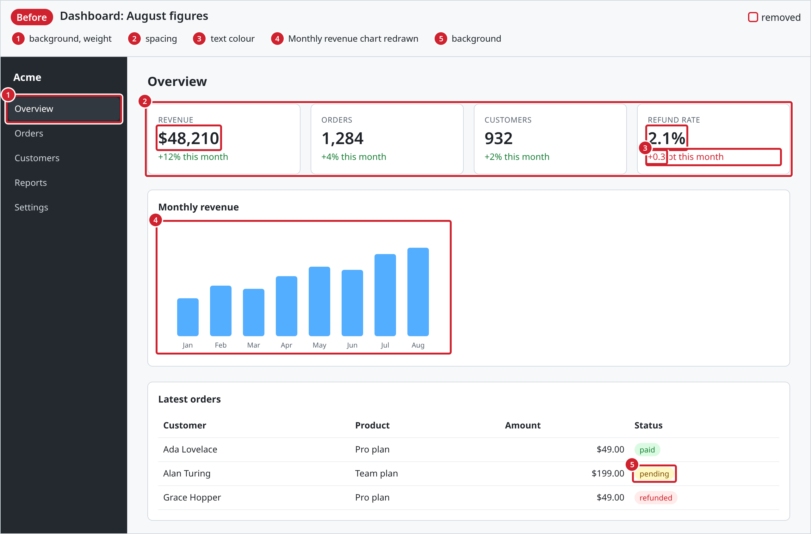 | 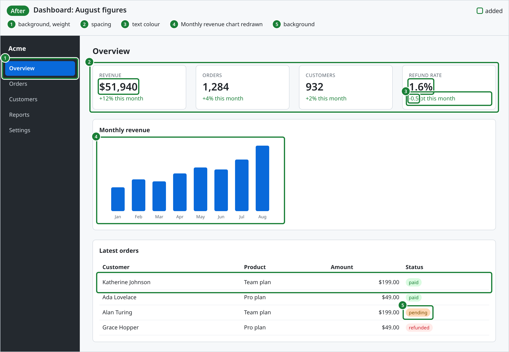 |

## Changes far apart

Changes too far apart for one image get a pair each, numbered in the file names and in the band ("1 of 2").

```sh
shot-diff "file://$PWD/e2e/fixtures/tall/before.html" "file://$PWD/e2e/fixtures/tall/after.html" \
  --title "Changes far apart"
```

```
examples/far-apart/shot-1-before.png: 1 part(s) removed
examples/far-apart/shot-1-after.png: 1 part(s) added
examples/far-apart/shot-2-before.png: 1 part(s) removed
examples/far-apart/shot-2-after.png: 1 part(s) added
```

| Before | After |
|---|---|
| 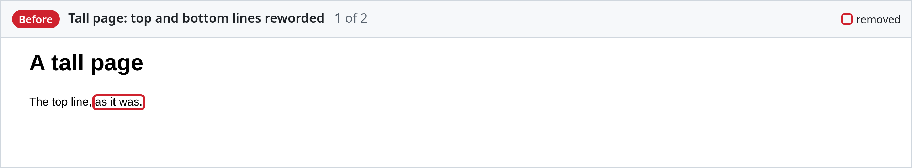 | 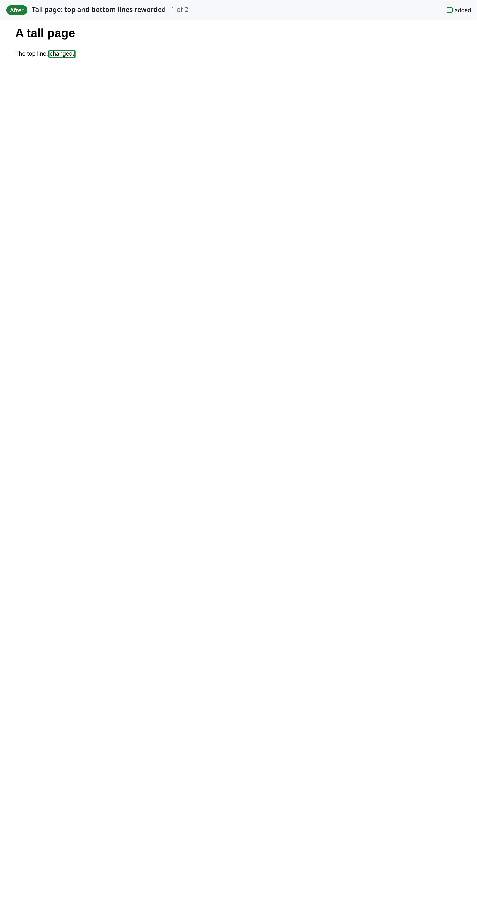 |
| 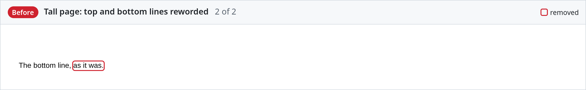 | 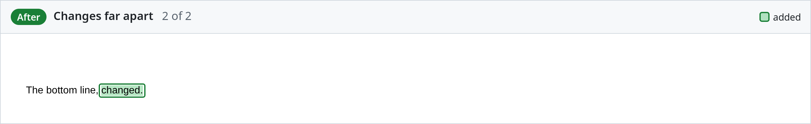 |

## One part of the page

With `--selector`, only the changes inside the element count. The others are left unmarked, and the terminal says how many.

```sh
shot-diff "file://$PWD/e2e/fixtures/tall/before.html" "file://$PWD/e2e/fixtures/tall/after.html" \
  --title "One part of the page" --selector "#end"
```

```
examples/selector/shot-before.png: 1 part(s) removed
examples/selector/shot-after.png: 1 part(s) added
shot-diff: 2 change(s) outside --selector ignored (listed under "ignored" in --json)
```

| Before | After |
|---|---|
| 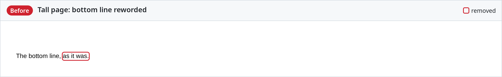 | 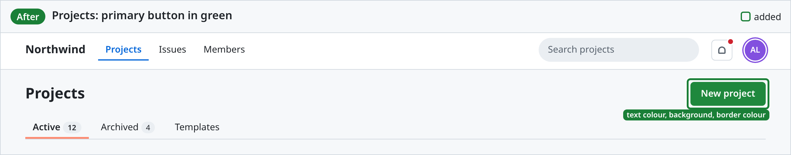 |

## A change a scroll area cuts off

A change past the edge of a scroll area cannot be shot: it gets no box, and the terminal lists it.

```sh
shot-diff "file://$PWD/e2e/fixtures/clipped/before.html" "file://$PWD/e2e/fixtures/clipped/after.html" \
  --title "A change a scroll area cuts off"
```

```
examples/scroll-area/shot-before.png: 1 part(s) removed
examples/scroll-area/shot-after.png: 1 part(s) added
shot-diff: 2 change(s) are in a part of the page a scroll area cuts off, so no image can show them:
  removed: as it was.
  added: changed.
```

| Before | After |
|---|---|
| 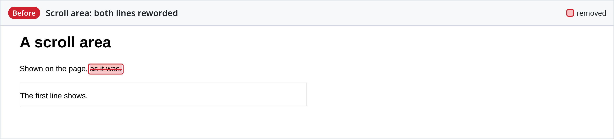 | 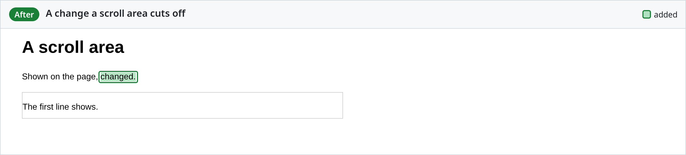 |

## A change taller than an image may be

A change that does not fit under `--max-height` is cut from the images, and the terminal lists it.

```sh
shot-diff "file://$PWD/e2e/fixtures/dashboard/before.html" "file://$PWD/e2e/fixtures/dashboard/after.html" \
  --title "A change taller than an image may be" --max-height 400
```

```
examples/too-tall/shot-1-before.png: 4 part(s) removed
examples/too-tall/shot-1-after.png: 4 part(s) added
examples/too-tall/shot-2-before.png: 1 part(s) removed
examples/too-tall/shot-2-after.png: 1 part(s) added
examples/too-tall/shot-3-before.png: 1 part(s) removed
examples/too-tall/shot-3-after.png: 2 part(s) added
```

| Before | After |
|---|---|
| 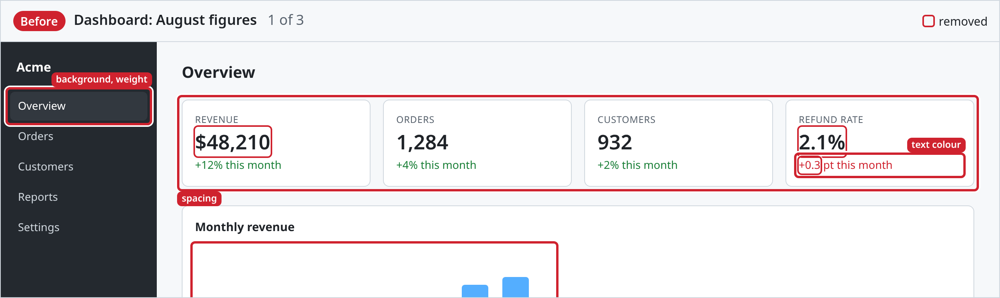 | 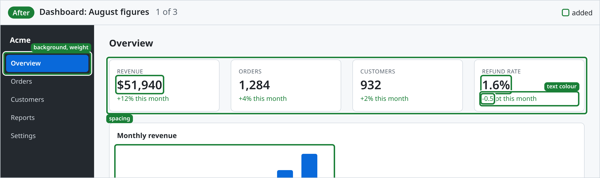 |
| 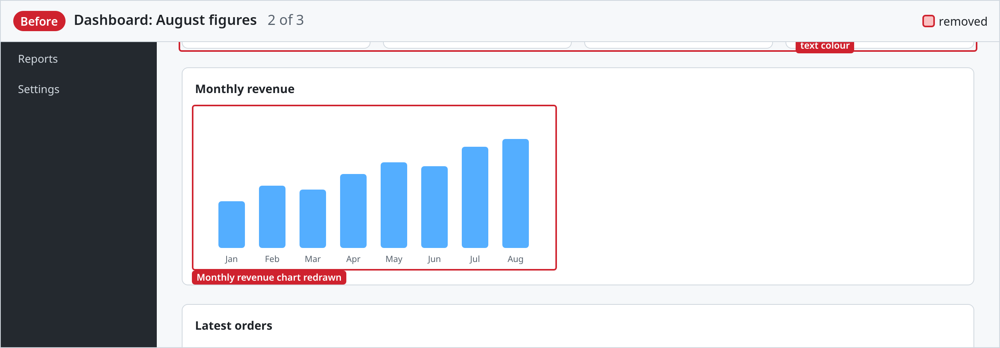 | 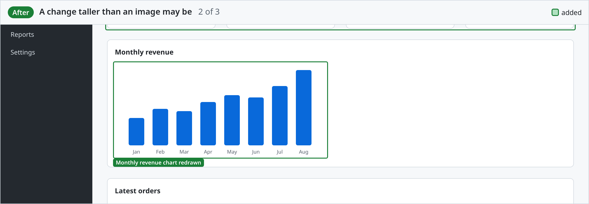 |
| 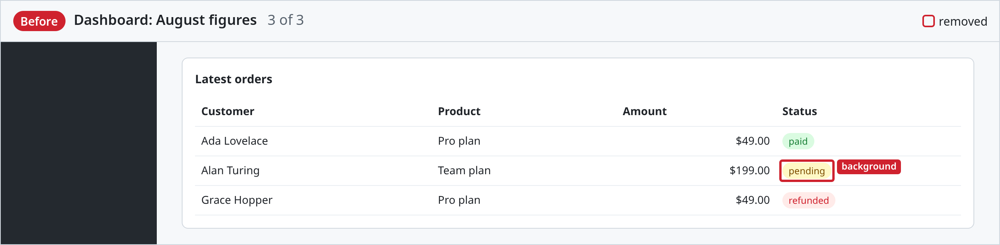 | 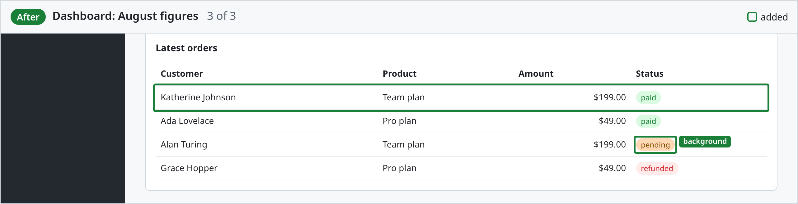 |

## Inside a web component

Changes in a shadow tree are marked as any other: here a price and a button inside the card, and the description the page gives it.

```sh
shot-diff "file://$PWD/e2e/fixtures/shadow/before.html" "file://$PWD/e2e/fixtures/shadow/after.html" \
  --title "Inside a web component"
```

```
examples/web-component/shot-before.png: 3 part(s) removed
examples/web-component/shot-after.png: 3 part(s) added
```

| Before | After |
|---|---|
| 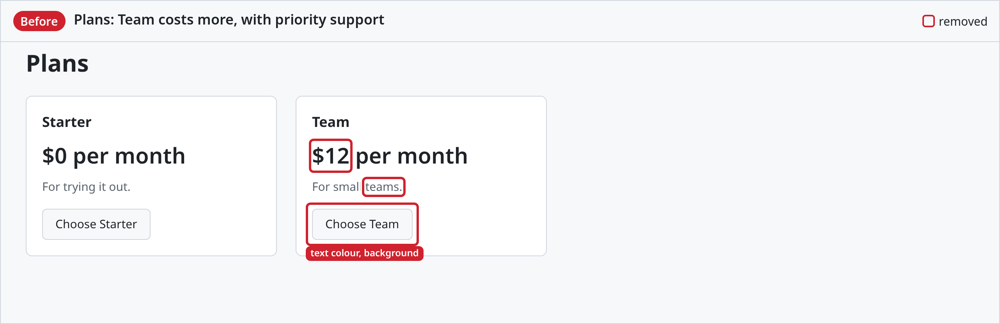 | 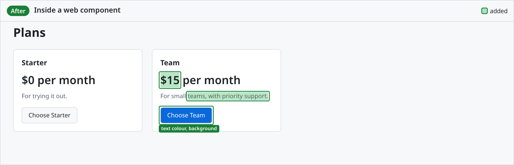 |

## Inside an embedded page

The words inside an iframe are not read: when it is drawn differently, the whole iframe is boxed as an "embedded page".

```sh
shot-diff "file://$PWD/e2e/fixtures/frame/before/index.html" "file://$PWD/e2e/fixtures/frame/after/index.html" \
  --title "Inside an embedded page"
```

```
examples/embedded-page/shot-before.png: 1 part(s) removed
examples/embedded-page/shot-after.png: 1 part(s) added
```

| Before | After |
|---|---|
| 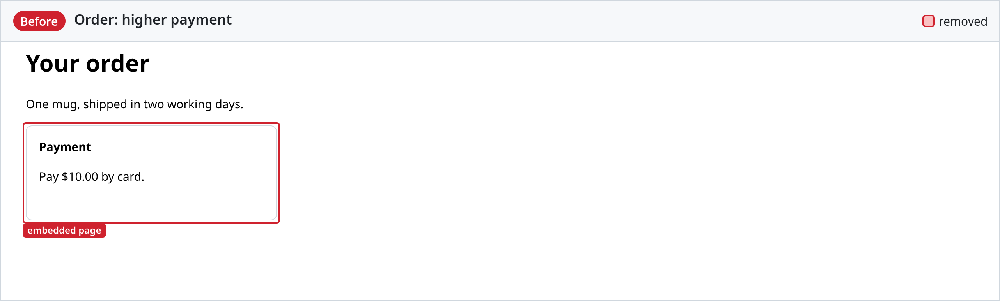 | 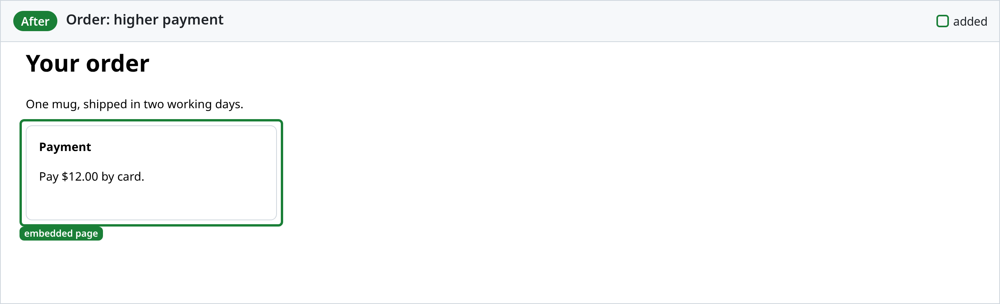 |

## A phone-sized page

The dashboard in a narrow window, with `--width` and `--height`.

```sh
shot-diff "file://$PWD/e2e/fixtures/dashboard/before.html" "file://$PWD/e2e/fixtures/dashboard/after.html" \
  --title "A phone-sized page" --width 390 --height 844
```

```
examples/phone/shot-before.png: 6 part(s) removed
examples/phone/shot-after.png: 7 part(s) added
```

| Before | After |
|---|---|
| 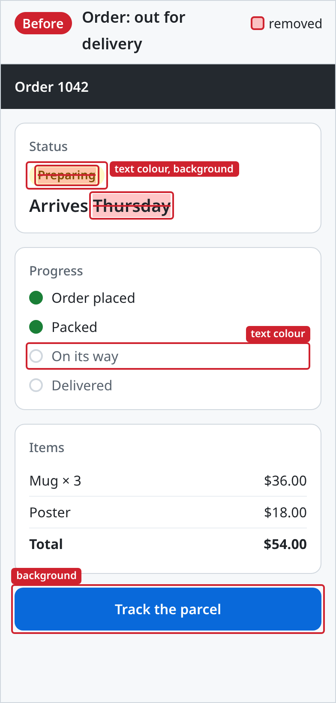 | 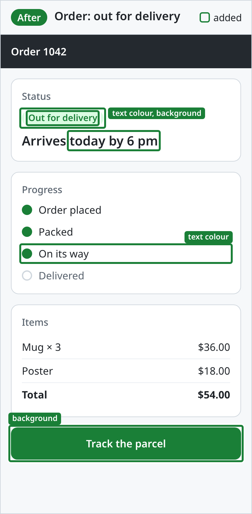 |

## No difference

Two pages that look the same: nothing is marked, the terminal says so, and the shots show the top of each page.

```sh
shot-diff "file://$PWD/e2e/fixtures/words/before.html" "file://$PWD/e2e/fixtures/words/before.html" \
  --title "No difference"
```

```
examples/no-difference/shot-before.png: 0 part(s) removed
examples/no-difference/shot-after.png: 0 part(s) added
shot-diff: no difference in the pages' words, images or looks; the shots show the top of each page
```

| Before | After |
|---|---|
| 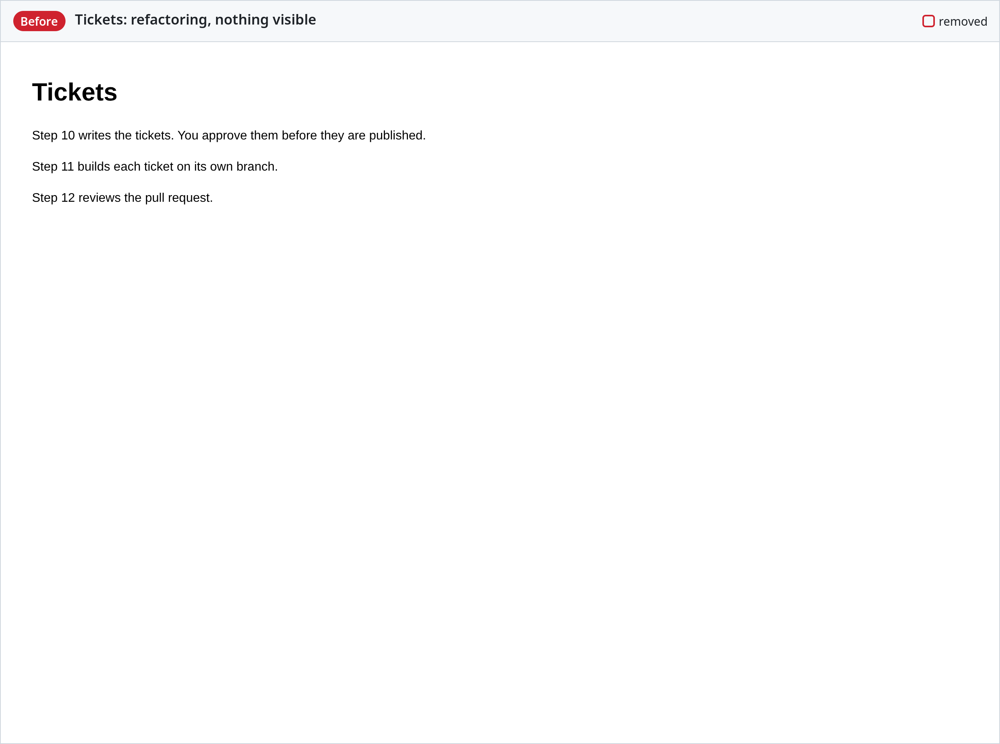 | 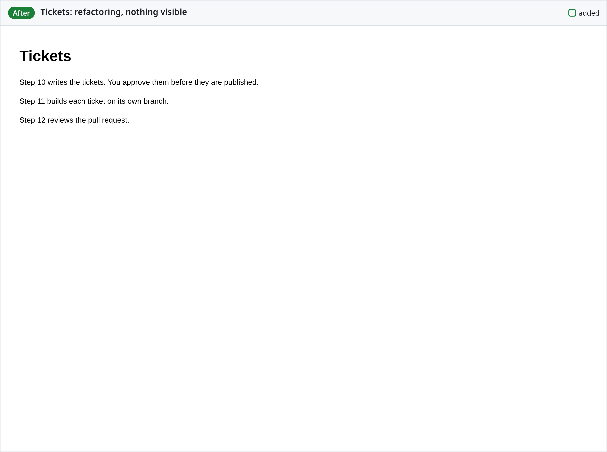 |

## A page set up by hand

With `--interactive`, both pages open in windows and are shot as you leave them. This shop looks the same in both versions until its cart is filled: run without `--interactive`, it is the "no difference" above.

```sh
shot-diff "file://$PWD/e2e/fixtures/shop/before.html" "file://$PWD/e2e/fixtures/shop/after.html" \
  --title "A page set up by hand" --interactive
```

1. Click **Add to cart** on Mug and on Poster.
2. Set the Mug quantity to 3.
3. Type `save10` in the promo field and click **Apply**.
4. Do the same in the other window, then press Enter in the terminal.

| Before | After |
|---|---|
| 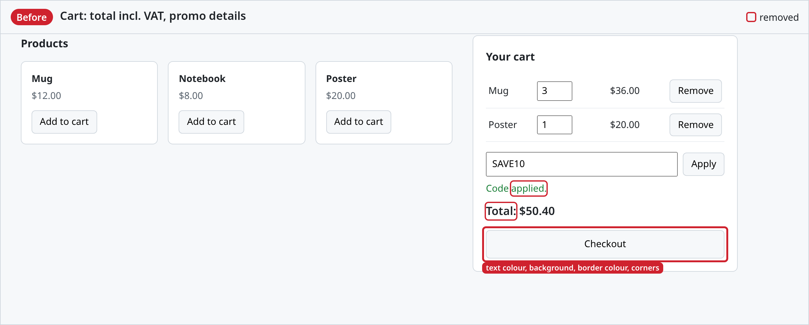 | 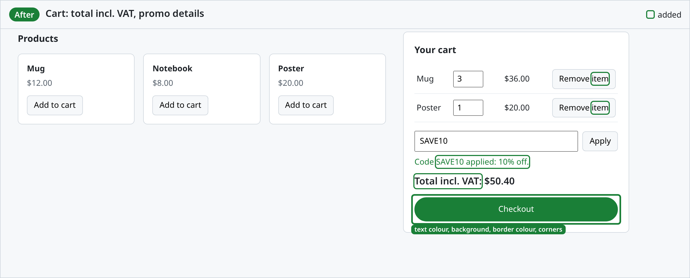 |
